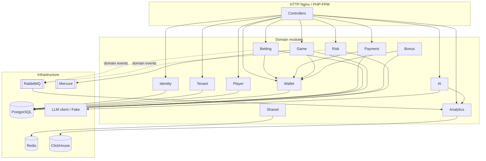

# Architecture

BLACK-TAIL is a **Symfony modular monolith**. Bounded contexts live under `src/<Module>/` with the usual layers:

- **Domain** - entities, value objects, domain events, repository ports, domain exceptions
- **Application** - commands/queries and handlers (use-cases)
- **Infrastructure** - Doctrine repos, HTTP controllers, Messenger listeners, external clients

Cross-cutting pieces (demo seed, request id, caches, ClickHouse client wiring) sit in **Shared**. HTTP is thin: controllers map the request, call a handler, return JSON. Persistence for transactional data is **PostgreSQL**; analytics facts go to **ClickHouse** via async Messenger (RabbitMQ; Compose `worker` must consume `async`). **Redis** backs cache and rate limiting. **Mercure** can publish demo Crash flight updates (optional locally).

## Module map

Edges are the important runtime dependencies only, not a full import graph.
**Bonus** has Application/Domain handlers only (no HTTP API). **Mercure** is demo-only for Crash flight UI, not a required production bus.
The `frontend/` SPA talks to this HTTP API through the Vite proxy (`/api` → `:8080`); it is part of the monorepo and uses live session cookies (no mock API layer).

## Key flows

### Bet accept / settle

1. Client places a bet (`POST /api/bets`), then accepts it (`POST /api/bets/{id}/accept`) with wallet + reserve ledger ids.
2. `AcceptBetHandler` reserves funds via Wallet (`ReserveWallet`).
3. Settle (`POST /api/bets/{id}/settle`) marks won/lost and settles or releases the wallet hold.
4. Domain events fan out through Messenger: analytics records (ClickHouse), optional bonus wagering / risk side effects. Async consumers run in the Compose `worker` service (`messenger:consume async`).
5. Bonus cash is locked on the wallet (`bonus_amount`) until wagering completes (then unlock to `available`); expire/cancel forfeits locked bonus so it is never withdrawable twice.

### Payment deposit / withdraw

1. Deposit (`POST /api/payments/deposits`) or withdrawal (`POST /api/payments/withdrawals`) creates a payment with an idempotency key.
2. Handlers drive Wallet ledger entries (credit on deposit success; reserve/release on withdraw).
3. Provider webhook / fail-stale paths update payment status without double-applying money (unique constraints + idempotent handlers).

### Crash cash-out

1. Crash round lifecycle lives in **Game** (`Open` / `Start` / `PublishFlight` / `Resolve`). Open/start HTTP is `ROLE_SUPER_ADMIN`; tick/resolve also exist as console commands.
2. Player places a crash bet, then cashes out (`CashOutCrashBetHandler`) against the **server** multiplier (elapsed from `startedAt`), not a client-sent value.
3. Wallet settle/payout runs in the same use-case path; Mercure can push flight updates for the demo UI (optional locally).

### AI ask

1. `POST /api/ai/ask` is rate-limited per authenticated user.
2. `AskAnalyticsQuestionHandler` builds a short analytics context (aggregates from Analytics / ClickHouse reads).
3. Question goes to an LLM client via **ConfigurableLlmClient**: empty `AI_LLM_BASE_URL` / `AI_LLM_API_KEY` → **FakeLlmClient**; both set → **HttpOpenAiCompatibleLlmClient** (OpenAI or Gemini OpenAI-compatible endpoint).

## HTTP map

Endpoint table: [api.md](api.md).
